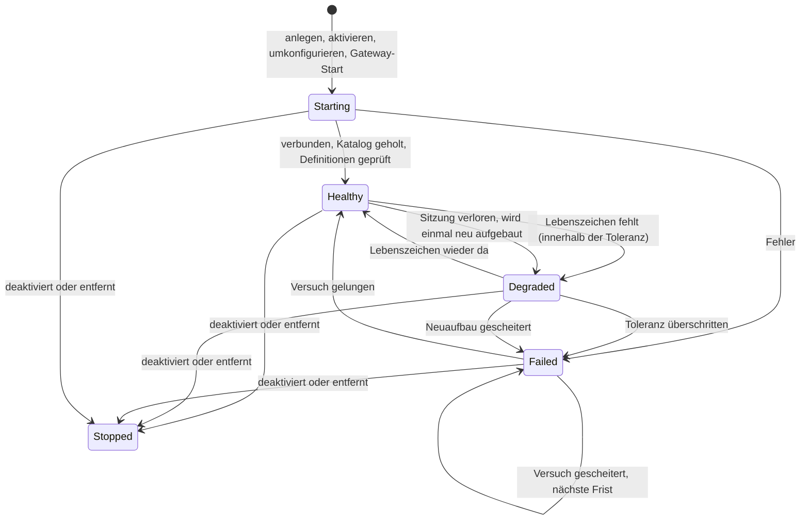

# Vertrag: Selbsttätige Wiederverbindung von Upstreams

**Stand:** 2026-11-18 · **Status:** abgenommen am 2026-11-16, E1 – E6 wie vorgeschlagen; Änderungen V1 – V5 (Abschnitt 9) abgenommen am 2026-11-18 · **Gilt für:** [Plan 0005](../plans/0005-upstream-wiederverbindung.md)
**Präzisierung in Abschnitt 4** („Gleichzeitige Aufrufe — gemessen"), entstanden beim Bau aus einer
Messung am echten SDK: ebenfalls am 2026-11-16 abgenommen.
**Anlass:** Ausfall auf Badwolf am 2026-11-16 — der Upstream „whiskers" blieb zwölf Stunden auf
`Failed`, obwohl er nach Sekunden wieder da war.

Weicht die Umsetzung von diesem Vertrag ab, wird zuerst der Vertrag geändert und erneut abgenommen.

## 1. Befund

### 1.1 Warum der Upstream liegen blieb

Es ist kein Fehler im Ablauf, sondern eine Grenze, die so gebaut und so getestet ist.

- `RestartPolicy.Default` ist `MaxRetries = 5`, Anfangsfrist 1 s, Faktor 2, Deckel 1 min
  (`src/Bifrost.Abstractions/Upstream.cs:342`).
- Der Run-Loop wartet nach den Fehlversuchen 1 + 2 + 4 + 8 + 16 s. Scheitert auch der sechste
  Versuch, **endet die Schleife** (`UpstreamSupervisor.cs:455–459`, Meldung „endgültig Failed … kein
  weiterer Restart").
- Bei „Connection refused" kostet ein Versuch nichts. Die ganze Geduld beträgt damit rund
  **31 Sekunden**. Ein Deploy, der den Container länger weg hat, überlebt das nicht.
- Danach läuft für diesen Upstream kein Code mehr. Nur Deaktivieren/Aktivieren, Bearbeiten oder ein
  Neustart des Gateways starten die Schleife neu — genau das, was am 16.11. geholfen hat.
- Der Test `Permanent_failure_after_exhausted_retries_stops_restarting` schreibt dieses Verhalten
  fest; die Anforderung FR-08 im PRD nennt „Max-Retries" ausdrücklich. Dieser Vertrag ändert also
  eine bewusste Entscheidung, keinen Programmierfehler.
- Im Tag `v0.11.0` — dem Stand, der auf Badwolf läuft — stehen dieselbe Vorgabe und dieselbe
  Abbruchbedingung (geprüft mit `git show v0.11.0:…`). Ein Update auf 0.12.0 allein hätte nichts
  geändert.

Dasselbe passiert beim **Start des Gateways**, wenn ein Upstream gerade nicht da ist: sechs
Versuche in einer halben Minute, dann Stille.

### 1.2 Drei Nebenbefunde aus dem Code

1. **Der Zähler wird sofort zurückgesetzt, nicht nach einer gesunden Minute.** `SupervisorOptions`
   beschreibt `HealthyResetWindow` als Voraussetzung; der Loop setzt `attempts = 0` aber gleich
   nach dem Verbinden (`UpstreamSupervisor.cs:367`). Mit unbegrenzten Versuchen würde ein
   Upstream, der verbindet und nach Sekunden stirbt, im Takt der Anfangsfrist neu gestartet — auf
   Dauer.
2. **Fehlertexte gehen ungefiltert hinaus.** `ex.Message` landet unverändert in `LastError`
   (Oberfläche, REST), im Audit-Detail und über das Ausnahmeobjekt im Log
   (`UpstreamSupervisor.cs:452, 462, 656`). Gemessen: Das SDK hängt an die Meldung den
   **Antwortkörper des Upstreams** an („… Response body: {…}"). Zitiert ein Upstream in seiner
   401-Antwort den vorgelegten Schlüssel oder dessen Anfang, steht er im Log.
3. **Jeder Wiederholungsversuch schreibt zwei Audit-Zeilen** (`Starting`, dann wieder `Failed`).
   Bei fünf Versuchen fällt das nicht auf; bei unbegrenzten wären es je totem Upstream rund 580
   Zeilen am Tag.

### 1.3 Gemessen: wie das SDK die Fälle meldet

Scratch-Projekt gegen `ModelContextProtocol` 2.0.0, Client über Streamable HTTP wie im Gateway.

| Fall | Was der Client wirft |
|---|---|
| Port geschlossen (beim Verbinden und mitten im Betrieb) | `HttpRequestException`, `StatusCode = null`, `HttpRequestError = ConnectionError`, innen `SocketException(ConnectionRefused)` |
| Server antwortet 401 / 403 / 404 / 500 / 503 | `HttpRequestException` mit dem jeweiligen `StatusCode` |
| Upstream **ohne** Sitzung (Fassung 2026-07-28, sessionlos) wird neu gestartet | **nichts** — der alte Client arbeitet weiter, der Neustart ist unsichtbar |
| Upstream **mit** `Mcp-Session-Id` (Fassung 2025-11-25) kennt die Sitzung nicht mehr | erster Aufruf: `HttpRequestException` 404. **Danach ist der Client tot:** jeder weitere Aufruf endet nach 0–5 ms mit `TaskCanceledException`, ohne dass eine Anfrage das Haus verlässt — auch wenn der Server längst wieder antwortet |

Zwei Folgen für den Vertrag: Das SDK baut eine verlorene Sitzung **nicht** selbst neu auf, und ein
404 allein beweist nichts — auf der Fassung 2026-07-28 beantwortet ein Server auch ein unbekanntes
Verfahren mit HTTP 404. Maßgeblich ist „404 **und** die Verbindung hatte eine Sitzung".

## 2. Zustandsmaschine

Die fünf Zustände bleiben, wie sie sind (`UpstreamState`: `Starting`, `Healthy`, `Degraded`,
`Stopped`, `Failed`). In der Sprache des Auftrags: CONNECTED ist `Healthy`; „disconnected" gibt es
als eigenen Zustand nicht — ein Upstream ohne Verbindung ist `Failed`.

Neu ist, was `Failed` über sich sagt:

| Fehlerart | Wann | Frist bis zum nächsten Versuch |
|---|---|---|
| `Unreachable` | alles, was nicht Authentifizierung ist: abgelehnte Verbindung, Zeitüberschreitung, 404, 5xx, Prozess startet nicht, unlesbare Werkzeugliste | exponentiell, siehe Abschnitt 3 |
| `Authentication` | HTTP 401 oder 403 beim Verbinden, bei der Katalogabfrage oder beim Lebenszeichen; fehlendes oder nicht erneuerbares OAuth-Token | feste lange Frist, siehe Abschnitt 3 |



Zusagen dieses Automaten:

- **Z1 — Aus `Failed` führt immer ein Weg heraus.** Solange der Upstream aktiviert ist, steht
  entweder ein Versuch aus oder einer läuft. Einzige Ausnahme ist eine **ausdrücklich
  konfigurierte** Obergrenze (Abschnitt 3.3); sie ist in Oberfläche und REST als solche zu sehen.
- **Z2 — Deaktiviert bleibt aus.** In `Stopped` gibt es keine Schleife, keinen Zeitgeber und keinen
  Versuch. „Jetzt verbinden" wird für einen deaktivierten Upstream abgelehnt.
- **Z3 — Wiederholungen flattern nicht.** Während des Wartens und während eines
  Wiederholungsversuchs bleibt der Zustand `Failed`. `Starting` gibt es nur beim ersten Versuch
  nach Anlegen, Aktivieren, Umkonfigurieren oder Gateway-Start.
- **Z4 — Jeder Versuch endet.** Ein Verbindungsversuch samt Katalogabfrage hat eine Frist von 60 s
  im Supervisor, unabhängig davon, was der Transport selbst begrenzt. Ein Versuch, der hängt,
  wäre derselbe stille Stillstand wie bisher.
- **Z5 — Der Zähler fällt erst nach einer gesunden Minute.** Die Zahl der Fehlversuche wird
  zurückgesetzt, wenn der Upstream `HealthyResetWindow` (60 s) am Stück gesund war — nicht schon
  beim Verbinden. Ein Upstream, der alle paar Sekunden stirbt, wandert so bis an den Deckel.
- **Z6 — Verbinden heißt immer dasselbe.** Jeder gelungene Versuch läuft durch dieselben Schritte
  wie der erste Anschluss: verbinden, `tools/list` (und Resources, Prompts) holen, jede
  Werkzeugdefinition gegen den festgehaltenen Stand prüfen. Geänderte Definitionen werden
  zurückgehalten, bis jemand sie annimmt; der Katalog meldet die Änderung wie bisher.

## 3. Fristen

### 3.1 Formel

```
nominal(n) = min(Deckel, Anfang × Faktor^(n−1))        n = Fehlversuche in Folge, ab 1
frist(n)   = nominal(n) × (1 − j)                      j gleichverteilt in [0, 0,2]
```

Der Jitter verkürzt nur. Der Deckel bleibt damit Deckel, und zwei Gateways, die denselben Upstream
verloren haben, treffen ihn nicht im Gleichschritt.

Mit den Vorgaben: 5 s → 10 s → 20 s → 40 s → 80 s → 160 s → 300 s → 300 s → …, ohne Ende.

Für die Fehlerart `Authentication` gilt keine Steigerung, sondern von Anfang an die feste lange
Frist (mit demselben Jitter). Wechselt die Fehlerart — der Upstream ist wieder erreichbar, lehnt
aber ab, oder umgekehrt —, gilt ab dem nächsten Versuch die Frist der neuen Art; der Zähler läuft
weiter.

### 3.2 Konfigurationsschlüssel

| Schlüssel | Vorgabe | Zulässig | Bedeutung |
|---|---|---|---|
| `BIFROST_UPSTREAM_RECONNECT_INITIAL_SECONDS` | `5` | 1 – 300 | Frist nach dem ersten Fehlversuch |
| `BIFROST_UPSTREAM_RECONNECT_MAX_SECONDS` | `300` | Anfang – 3600 | Deckel der Frist |
| `BIFROST_UPSTREAM_RECONNECT_AUTH_SECONDS` | `900` | Deckel – 86400 | Frist nach einer abgelehnten Authentifizierung |

Ein ungültiger Wert setzt die Vorgabe und erzeugt eine Warnung beim Start — er führt nicht dazu,
dass der Gateway nicht hochkommt. Die Schlüssel stehen in `docs/operations.md` und `.env.example`
(der Governance-Test verlangt das). Nach der Umbenennung heißen sie `FAOLAN_…`; die Kette aus dem
[Umbenennungsvertrag](umbenennung-faolan.md) arbeitet auf dem Präfix und nimmt sie ohne Zutun mit.

**Bewusst nicht einstellbar:** Faktor (2), Jitter (20 %), Frist je Versuch (60 s),
`HealthyResetWindow` (60 s), Frist für den Neuaufbau einer Sitzung (15 s). Einen globalen
Ausschalter gibt es nicht — wer einen Upstream nicht wiederverbunden haben will, deaktiviert ihn.

### 3.3 Einstellung je Upstream

Das Feld `restart` der Upstream-Konfiguration bleibt und überschreibt die globalen Werte für
diesen einen Upstream. Geändert wird die Bedeutung von `maxRetries`:

| `restart` | Verhalten |
|---|---|
| fehlt (der Regelfall — die Oberfläche setzt das Feld nie) | globale Werte, **unbegrenzt** |
| vorhanden, `maxRetries` fehlt oder `null` | eigene Fristen, unbegrenzt |
| vorhanden, `maxRetries` = Zahl | eigene Fristen, Grenze wie bisher. Ist sie erreicht, steht in Status und Oberfläche „Wiederverbindung nach N Versuchen eingestellt (so konfiguriert)"; „Jetzt verbinden" funktioniert weiter |

Eine ausdrücklich gesetzte Grenze ist eine Entscheidung des Betreibers und wird nicht stillschweigend
aufgehoben. Aus dem Code ist kein Weg ersichtlich, auf dem `restart` ohne Handarbeit an der
JSON-Konfiguration gesetzt würde; für „whiskers" auf Badwolf wird das vor dem Deploy über die
Versionshistorie geprüft.

## 4. Verlorene Sitzung mitten im Betrieb

Betrifft nur Upstreams mit `Mcp-Session-Id`. Ein sessionloser Upstream (Fassung 2026-07-28)
übersteht seinen eigenen Neustart ohne Zutun (gemessen, 1.3).

**Erkennung.** Die Verbindung selbst übersetzt „HTTP 404 auf eine Anfrage, während eine
Sitzungs-Id besteht" in `UpstreamSessionLostException`. Oberhalb der Verbindung gibt es weiterhin
keine SDK-Typen.

**Ablauf.**

1. Der Aufruf, der das 404 bekommt, löst **einen** Neuaufbau aus. Gleichzeitige und nachfolgende
   Aufrufe warten auf denselben Neuaufbau, statt je einen eigenen zu starten.
2. Der Neuaufbau ist ein Verbinden nach Z6 — mit Katalogabfrage und Definitionsprüfung — ohne
   Wartefrist und ohne den Fehlversuchszähler zu erhöhen. Er hat 15 s Zeit. Der Zustand ist
   währenddessen `Degraded` mit dem Hinweis „Sitzung verloren, wird neu aufgebaut".
3. Gelingt er, wird der Aufruf **genau einmal** wiederholt — aber nur, wenn das Werkzeug im
   geprüften Katalog noch steht. Fehlt es oder wird seine geänderte Definition zurückgehalten,
   endet der Aufruf mit einer Meldung, die das sagt.
4. Scheitert der Neuaufbau oder die Wiederholung, bekommt der Client den Fehler. Ein zweiter
   Neuaufbau für denselben Aufruf findet nicht statt; bei gescheitertem Neuaufbau geht der
   Upstream auf `Failed`, und Abschnitt 3 übernimmt.

**Was nicht wiederholt wird.** Jeder andere Fehler mitten im Aufruf — abgerissene Verbindung,
Zeitüberschreitung, 5xx. Dort ist nicht zu wissen, ob der Upstream den Aufruf schon ausgeführt
hat, und ein zweites `create_issue` ist schlimmer als ein gemeldeter Fehler. Das 404 auf die
Sitzung ist der eine Fall, in dem feststeht, dass nichts ausgeführt wurde.

Gilt für `tools/call`, `resources/read` und `prompts/get` gleichermaßen: Die Wiederholung sitzt in
dem Objekt, das `GetConnection` herausgibt. Die Aufrufer ändern sich nicht.

**Gleichzeitige Aufrufe — gemessen (Präzisierung vom 2026-11-16, abgenommen am selben Tag).** Punkt 1
oben sagt, gleichzeitige Aufrufe warteten auf denselben Neuaufbau. Der Integrationstest gegen das
echte SDK zeigt, was dabei wirklich ankommt: Sobald **eine** Anfrage das 404 auf die Sitzung
bekommt, beendet sich der SDK-Client und **bricht alle anderen ab, die gerade unterwegs sind**. Sie
sehen kein eigenes 404, sondern einen Abbruch. Daraus folgt:

| Aufruf | Was geschieht |
|---|---|
| bekommt selbst das 404 | wartet auf den einen Neuaufbau und wird einmal wiederholt |
| beginnt, nachdem das 404 gesehen wurde | geht gar nicht mehr an die tote Verbindung, wartet auf denselben Neuaufbau, läuft dann |
| war schon unterwegs und wird vom SDK abgebrochen | **wird nicht wiederholt.** Der Aufrufer bekommt den Fehler „Die Verbindung zum Upstream wurde während der Operation … abgebaut … nicht wiederholt" |

Die dritte Zeile ist die Regel aus „Was nicht wiederholt wird", angewandt auf diesen Fall: Eine
Anfrage, die schon unterwegs war, kann der Upstream ausgeführt haben, bevor seine Sitzung endete —
aus einem Abbruch ist das nicht abzulesen. Es bleibt bei **einem** Neuaufbau, und kein Aufruf läuft
doppelt; nur gelingen nicht alle zehn. Die Alternative — abgebrochene Aufrufe ebenfalls wiederholen
— würde alle zehn durchbringen, könnte aber einen lange laufenden Aufruf doppelt ausführen, und
widerspräche damit E4.

## 5. Schnittstellen

### 5.1 Abstractions

```csharp
public enum UpstreamFailureKind
{
    None = 0,
    Unreachable = 1,
    Authentication = 2,
}

/// <summary>Nur gesetzt, solange der Upstream Failed ist.</summary>
public sealed record UpstreamReconnectInfo(
    UpstreamFailureKind Kind,
    int Attempt,                    // Fehlversuche in Folge
    DateTimeOffset? NextAttemptAt,  // null: ein Versuch läuft gerade, oder Exhausted
    bool Exhausted);                // ausdrücklich konfigurierte Grenze erreicht

public sealed record UpstreamStatus(
    ServerId Id, string Slug, UpstreamState State, string? LastError,
    int ToolCount, DateTimeOffset LastHealthyAt,
    IReadOnlyList<string>? QuarantinedTools = null,
    UpstreamReconnectInfo? Reconnect = null);          // neu, am Ende

public sealed record RestartPolicy(
    int? MaxRetries,                // war int; null = unbegrenzt
    TimeSpan InitialBackoff, double BackoffMultiplier, TimeSpan MaxBackoff)
{
    public static RestartPolicy Default { get; } =
        new(null, TimeSpan.FromSeconds(5), 2.0, TimeSpan.FromMinutes(5));
}

public interface IUpstreamSupervisor
{
    // … unverändert …

    /// <summary>
    /// Stößt für einen Upstream im Zustand Failed sofort einen Versuch an. Wartet nicht auf das
    /// Ergebnis. true = Versuch angestoßen; false = nichts zu tun (verbunden, oder ein Versuch
    /// läuft bereits). Der Fehlversuchszähler bleibt stehen.
    /// </summary>
    /// <exception cref="KeyNotFoundException">Unbekannter Upstream.</exception>
    /// <exception cref="InvalidOperationException">Der Upstream ist deaktiviert.</exception>
    Task<bool> ConnectNowAsync(ServerId id, CancellationToken ct);
}

public sealed class UpstreamAuthenticationException : Exception { /* übliche Konstruktoren */ }
public sealed class UpstreamSessionLostException : Exception { /* übliche Konstruktoren */ }
```

`UpstreamChangedEventArgs` bleibt unverändert. Ein neu geplanter Versuch meldet sich als
`StateChanged`, damit die Oberfläche die neue Frist sieht — ohne Audit-Zeile.

### 5.2 Core

- `SupervisorOptions` bekommt `AuthenticationRetryInterval` (15 min), `ConnectAttemptTimeout`
  (60 s), `SessionRebuildTimeout` (15 s), `ReconnectJitter` (0,2) und eine Zufallsquelle, die Tests
  festnageln können. `DefaultRestartPolicy` nimmt die neuen Vorgaben.
- Die Einordnung eines Fehlers ist **eine** reine Funktion `Exception → UpstreamFailureKind`: Sie
  geht die Kette der inneren Ausnahmen durch; `HttpRequestException` mit 401 oder 403 und
  `UpstreamAuthenticationException` ergeben `Authentication`, alles andere `Unreachable`.
- Der HTTP-Connector wirft `UpstreamAuthenticationException`, wo heute eine
  `InvalidOperationException` sagt, dass kein OAuth-Token vorliegt oder die Erneuerung scheiterte.

### 5.3 REST

| Was | Änderung |
|---|---|
| `GET /api/v1/servers` | je Eintrag zusätzlich `failureKind` (`"Unreachable"`, `"Authentication"` oder `null`), `reconnectAttempt` (Zahl), `nextAttemptAt` (ISO 8601 oder `null`), `reconnectExhausted` (bool). Nur Ergänzungen. |
| `POST /api/v1/servers/{id}/connect` (Admin) | neu. `202` mit `{ "triggered": true|false, "state": "…" }`; `404` unbekannt; `409` deaktiviert. Erzeugt eine Audit-Zeile `server-connect-requested`. |

Die Gateway-CLI liest `servers list` als JSON durch; die neuen Felder erscheinen dort von selbst.
Ein eigener CLI-Befehl `servers connect` ist **nicht** Teil dieses Vertrags.

### 5.4 Server-Verwaltung

In der Zeile eines Upstreams im Zustand `Failed`, unter dem Zustandsschild:

| Lage | Text |
|---|---|
| Versuch steht aus | „Versuch 7 · nächster Versuch in 40 s" (zählt sichtbar herunter; ab 90 s in Minuten) |
| Versuch läuft | „Versuch 7 · verbindet …" |
| Authentifizierung abgelehnt | „Authentifizierung abgelehnt · nächster Versuch in 14 min" |
| konfigurierte Grenze erreicht | „Wiederverbindung nach 5 Versuchen eingestellt (so konfiguriert)" |

Dazu der Knopf **„Jetzt verbinden"**, sichtbar genau im Zustand `Failed`. Die Zeile trägt
`data-failure-kind`, `data-reconnect-attempt` und `data-next-attempt-at`, der Knopf
`data-testid="server-connect-now"` — der Browsertest prüft Daten, nicht Fließtext.

## 6. Protokollierung

**Was geschrieben wird.** Genau eine Logzeile und eine Audit-Zeile (`ServerLifecycle`) je
tatsächlichem Wechsel:

| Wechsel | Inhalt |
|---|---|
| → `Failed` | Slug, Fehlerart, bereinigter Grund |
| Fehlerart wechselt, Zustand bleibt `Failed` | Slug, alte und neue Fehlerart |
| `Failed` → `Healthy` | Slug, Dauer des Ausfalls, Zahl der Versuche, Zahl der Werkzeuge |
| → `Degraded`, → `Stopped`, konfigurierte Grenze erreicht | wie bisher bzw. sinngemäß |

Ein einzelner Wiederholungsversuch, der wieder scheitert, schreibt **nichts** ins Audit und ins Log
nur auf Stufe `Debug`.

**Was nie hineinkommt.** Für jeden Text, der in Log, Audit, `LastError`, Oberfläche oder REST
landet:

- **P1** — Der Grund wird vom Gateway formuliert: Fehlerart, HTTP-Status, Zielrechner und Port.
  Keine Abfragezeichenkette, keine Benutzerangabe aus der Adresse.
- **P2** — Der Antwortkörper des Upstreams wird nie übernommen.
- **P3** — Was von einer fremden Meldung übrig bleibt, läuft durch die bestehende
  `ScrubSecrets`-Bereinigung, erweitert um Anfangsstücke: Jeder konfigurierte Geheimwert wird auch
  dann maskiert, wenn nur seine ersten sechs oder mehr Zeichen vorkommen. Bei Kopfzeilen der Form
  „Bearer …" oder „Basic …" zählt als Geheimwert der Teil nach dem Schema.
- **P4** — Das Ausnahmeobjekt geht für diese Ereignisse nicht an den Logger (seine Textform trüge
  die ungefilterte Meldung). Geloggt werden die Typnamen der Ausnahmekette.

## 7. Nachweise

Ein Paket gilt als fertig, wenn ein Lauf über **alle** Testprojekte der Solution vorliegt, geprüft
wie in der CI, mit Befehl und Zahlen.

| Zusage | Test |
|---|---|
| Upstream fällt aus und kommt wieder → `Healthy`, Werkzeuge da, kein Eingriff | Core: Fake-Connector scheitert 20-mal, dann nicht mehr; Integration: echter HTTP-Testserver wird beendet und auf demselben Port neu gestartet |
| Fristen 5/10/20/40/80/160/300/300, Jitter nur nach unten | Core, mit festgenagelter Zufallsquelle und `FakeTimeProvider` |
| Auth-Fehler → keine schnelle Schleife | Core: 401 beim Verbinden; in 14 min Testzeit genau ein Versuch. Integration: Testserver antwortet 401, Zähler der eingehenden Anfragen |
| Wechsel der Fehlerart wechselt die Frist | Core |
| Deaktiviert → kein Versuch, auch nach Stunden Testzeit; `ConnectNowAsync` lehnt ab | Core |
| Z3: Wiederholungen erzeugen kein `Starting` und keine Audit-Zeile | Core, zählt Audit-Ereignisse über 50 Fehlversuche |
| Z4: ein hängender Versuch endet nach der Frist und der nächste folgt | Core |
| Z5: Upstream, der nach 5 s stirbt, erreicht den Deckel | Core |
| Z6: nach der Wiederverbindung wird eine geänderte Definition zurückgehalten | Core, mit Pin-Store |
| `maxRetries` ausdrücklich gesetzt → Grenze gilt, `Exhausted` sichtbar, „Jetzt verbinden" geht | Core |
| Sitzung verloren → ein Neuaufbau, Aufruf gelingt | Integration: Testserver mit Sitzungen, antwortet einmal 404 auf die Sitzung |
| zehn gleichzeitige Aufrufe → ein Neuaufbau, kein Aufruf doppelt | Integration, zählt `initialize` und Ausführungen; abgebrochene Aufrufe enden mit der Meldung aus Abschnitt 4 |
| abgerissene Verbindung mitten im Aufruf → **keine** Wiederholung | Integration, zählt Ausführungen des Werkzeugs |
| Werkzeug nach Neuaufbau zurückgehalten → Aufruf endet mit Meldung, wird nicht ausgeführt | Integration |
| P1 – P4: Schlüssel und sein Anfangsstück stehen in keinem Log, Audit, `LastError` | Core: Upstream zitiert den Schlüssel im 401-Körper; geprüft werden alle fünf Senken |
| REST: neue Felder, `connect` mit 202 / 404 / 409 | Integration |
| Oberfläche: Frist, Versuchszahl, Knopf | Browsertest über die `data-`Attribute |
| jeder neue Schlüssel ist dokumentiert | bestehender Governance-Test |

Zwei bestehende Tests ändern sich mit Absicht und werden im Bericht genannt:
`RestartPolicy_default_uses_exponential_backoff` (prüft heute `MaxRetries == 5`) und
`Permanent_failure_after_exhausted_retries_stops_restarting` (gilt künftig nur noch für eine
ausdrücklich gesetzte Grenze).

## 8. Vom Nutzer zu entscheiden

Jeweils mit meinem Vorschlag; der Vertrag oben ist so geschrieben, als wäre er angenommen.

| # | Frage | Vorschlag |
|---|---|---|
| E1 | Was geschieht mit einer ausdrücklich gesetzten `maxRetries`? | Bleibt gültig und wird sichtbar gemacht (3.3). Alternative: künftig ignorieren — dann gibt es gar kein endgültiges `Failed` mehr. |
| E2 | Frist nach abgelehnter Authentifizierung | fest 15 min, unbegrenzt viele Versuche |
| E3 | Setzt „Jetzt verbinden" den Zähler zurück? | Nein. Scheitert der Versuch, geht es an der alten Stelle der Fristenfolge weiter. |
| E4 | Wiederholung nach verlorener Sitzung nur beim 404 auf die Sitzung? | Ja (Abschnitt 4). Alles andere könnte einen Aufruf doppelt ausführen. |
| E5 | Bei OAuth-Upstreams gibt es schon einen Link „Verbinden" (startet die Autorisierung). Zwei fast gleiche Beschriftungen nebeneinander? | Den bestehenden Link in „Autorisieren" umbenennen. Nicht Teil des Auftrags — nur mit Zustimmung. |
| E6 | Eigenes ADR? | Nein. Der Vertrag ändert die Vorgabe einer Policy aus ADR-0005, nicht die Architektur. Auf Wunsch als ADR-0029. |

## 9. Änderungen vom 2026-11-18

**Status: abgenommen am 2026-11-18, V1 – V5 wie vorgeschlagen.** Aus den Lesedurchgängen nach dem Merge (Plan 0005, „Restarbeiten").
Wo eine Zeile einer Zusage in den Abschnitten 1 – 8 widerspricht, gilt die Spalte „Vorschlag" dieser
Tabelle; die Alternativen sind verworfen.

| # | Fund | Heute (Vertrag) | Vorschlag | Alternative |
|---|---|---|---|---|
| V1 | H1 | Ein 401 gilt als abgelehnte Anmeldung → feste Frist von 15 min (E2), auch auf einer stehenden Verbindung, deren OAuth-Token nur abgelaufen ist. | Ein 401 auf einer **stehenden** Verbindung eines OAuth-Upstreams erneuert das Token (Refresh-Token) und verbindet **sofort einmal** neu, ohne Frist und ohne Fehlversuch. Erst ein 401 auf dieser neuen Verbindung oder ein abgelehntes Refresh gilt als abgelehnt (E2). Der laufende Aufruf wird nicht wiederholt (Abschnitt 4 bleibt). | Token vor Ablauf vorsorglich erneuern (Zeitpunkt aus `ExpiresAt`); löst nur den Ablauf, nicht den Widerruf. |
| V2 | L2 | Ein Neuaufbau der Sitzung hat keine Frist und erhöht den Zähler nicht (Abschnitt 4, Punkt 2) — auch nicht, wenn er sich alle paar Sekunden wiederholt (Lastverteiler ohne feste Zuordnung). | Mehr als **3** Neuaufbauten in **5 min** gelten als Ausfall: Der Upstream geht auf `Failed` (Fehlerart `Unreachable`, Grund „Sitzung geht wiederholt verloren"), Abschnitt 3 übernimmt. | Neuaufbauten nur zählen und ab der Schwelle im Log und Audit melden, ohne den Zustand zu ändern. |
| V3 | S3, T4 | `IAuditSink.Record` wirft bei vollem Kanal; jeder Wurf zählt in `AuditLossFacts` als Verlust — auch ein Nachreich-Versuch einer zurückgestellten Zeile (bei vollem Kanal je Versuch und Lebenszeichen). Verworfene Zeilen (Überlauf der 32, Entfernen) zählen nie. | `IAuditSink` bekommt `bool TryRecord(AuditEvent)`: nimmt an oder gibt `false` zurück, **ohne** als Verlust zu zählen. Der Loop reicht damit nach. Als Verlust zählt eine Zeile genau dann, wenn sie **verworfen** wird (Überlauf, Entfernen, Beenden). | So lassen und die Verfälschung von BFR-DB-0007 in der Diagnose dokumentieren. |
| V4 | S6 | Nicht geregelt. Die Audit-Zeile zu einer geänderten Werkzeugdefinition (Rug-Pull-Prüfung) geht direkt ans Audit; bei vollem Kanal im Compliance-Modus scheitert damit jeder Verbindungsversuch. | **So lassen (fail-closed)** und hier festschreiben: Eine Definitionsänderung, die das Audit nicht annimmt, verhindert die Verbindung. Sie ist ein Sicherheitsereignis; eine Verbindung, deren Prüfung nicht belegt werden kann, wird nicht aufgebaut. | Zurückstellen wie die Zustandszeilen; die Verbindung kommt zustande, das Werkzeug bleibt zurückgehalten. |
| V5 | M3 | P1 – P3 erlauben, was von einer fremden Meldung nach Abschneiden des Antwortkörpers und Maskieren übrig bleibt. | **So lassen**, mit der schon gebauten Verschärfung: Auch „Verbindung testen" läuft durch dieselbe Bereinigung, und P3 maskiert zusätzlich das OAuth-Client-Secret und die Werte geheimnisartiger Stdio-Schalter (`--token=…`, `--api-key …`). Begründung: Rund 140 Stellen im Gateway werfen Standardtypen mit eigenem, nützlichem Text (Spec-Fehler bei OpenAPI/OpenRPC, Container- und CLI-Prüfungen). | Für **unbekannte** Ausnahmetypen formuliert das Gateway den Grund vollständig selbst („Verbindung gescheitert (`IOException`)" plus Ziel). Nimmt Betreibern die Diagnose oben, bis diese Stellen eigene Typen haben. |

**Präzisierung zu V1 beim Bau (2026-11-18).** „Ein 401 auf dieser neuen Verbindung" heißt: ein 401,
bevor die neue Verbindung eine Minute gesund war (`HealthyResetWindow`, wie Z5). Ein Token, das
eine Stunde später regulär wieder abläuft, wird erneut erneuert und nicht als abgelehnte Anmeldung
gewertet. Erkannt wird das 401 am Lebenszeichen; Upstreams mit festem Schlüssel (ohne OAuth)
bleiben bei E2. Wer die alte Verbindung noch hält, wartet auf die neue — wie nach einem 404 auf
die Sitzung. Neuaufbauten wegen eines erneuerten Tokens zählen nicht in die Bremse aus V2.
